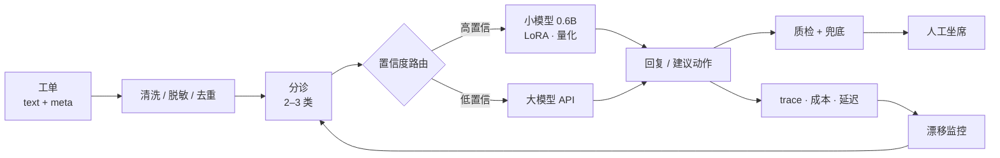

# ticket-loop

**客服工单的端到端竖切。用 eval 当脊柱，把 L0 → L4 完整走一遍。**

原先我只负责这条链上的一个点：领域基模的评测集、场景归类、补强集。
这个仓库做的是反过来的事 —— **从一张工单进来，到一次可运营的闭环**，
把数据、训练、评测、服务、路由、兜底、观测串成一条线，每一层都留下可复现的数字。

> 阶段 0 · 骨架已建（2026-11-21）

---

## 一条线



三个要回答的问题，对应三条主线：

| 主线 | 回答什么 | 对应层 | 产出 |
|---|---|---|---|
| **eval** | 什么叫「做对了」 | L4 | golden set、指标、错误归因 |
| **train** | 小模型到底值不值 | L0 | LoRA 0.6B + 量化 + A/B 对比 |
| **serve** | 峰值扛不扛得住 | L1/L3 | 并发/延迟/成本压测报告 |

---

## 指标（每周更新，先占位）

| 维度 | 指标 | baseline | 当前 | 目标 |
|---|---|---|---|---|
| 分诊质量 | 宏 F1 | — | — | ≥ 0.90 |
| 分诊质量 | 置信度校准 ECE | — | — | ≤ 0.05 |
| 回复质量 | rubric 通过率 | — | — | ≥ 0.85 |
| 成本 | 每千工单成本 | — | — | 比全大模型降 ≥ 40% |
| 延迟 | P95 首响 | — | — | ≤ 2s（待公司 SLA 校准） |
| 稳定性 | 峰值成功率 | — | — | ≥ 99%（压测） |

> 数字不是越高越好。**能解释「用 2% 质量换 40% 成本」才是这个项目的价值。**

---

## 目录

```
docs/            愿景、架构、计划、评测、算力、待答问题、决策记录
data/            schema；raw 可拉取，private 永不入库，synthetic 可提交
src/cs_agent/    数据 / 评测 / 训练 / 服务 / 路由 / agent / 观测
scripts/         入口脚本（Windows 友好，不用 make）
eval/            golden set（公开部分入库）+ 评测产物
tests/           冒烟测试
```

详细阅读顺序：`docs/00-vision.md` → `02-plan.md` → `03-eval-design.md` → `04-compute-budget.md`。

---

## 怎么跑

```powershell
# 1. 环境（uv 会自动下载合适的 Python，>=3.11）
uv sync

# 2. 摸一下本机底细：显卡、显存、0.6B 能不能训
uv run python scripts/check_env.py

# 3. 冒烟测试
uv run pytest -q

# 4. 代码检查
uv run ruff check .
```

依赖按阶段加，见 `docs/02-plan.md`。**阶段 0 不装 torch**，先把账算明白。

---

## 阶段

| 阶段 | 内容 | 验收 |
|---|---|---|
| P0 | 愿景 + 骨架 | 本仓库 |
| P1 | 数据 + eval harness | `uv run python scripts/run_eval.py --baseline` 出分 |
| P2 | 算力账本 + LoRA 0.6B | 估算值与实测值的偏差 ≤ 30% |
| P3 | 服务 + 压测 | 一张 QPS–P95–成本 曲线 |
| P4 | 路由 + 兜底 | 质量不掉、成本下降 |
| P5 | 观测 + 漂移演练 | 一次人为注入漂移的完整报告 |
| P6 | case study + demo | 3 分钟视频 + 一页纸 |

---

## 不做清单

- ❌ 不做通用 Agent 平台（那是 L1 红海，且不是我的问题）
- ❌ 不做多轮复杂对话（单轮分诊 + 单轮回复足够验证链路）
- ❌ 不做前端框架（CLI + 一个单页即可）
- ❌ 不做多机多卡（单卡 6GB 就是约束条件，正好练估算）
- ❌ 不追 SOTA 模型（要证明的是**流程和取舍**，不是榜单）

---

## 一句话

> **把一个点，做成一整条能自证效果的线。**
